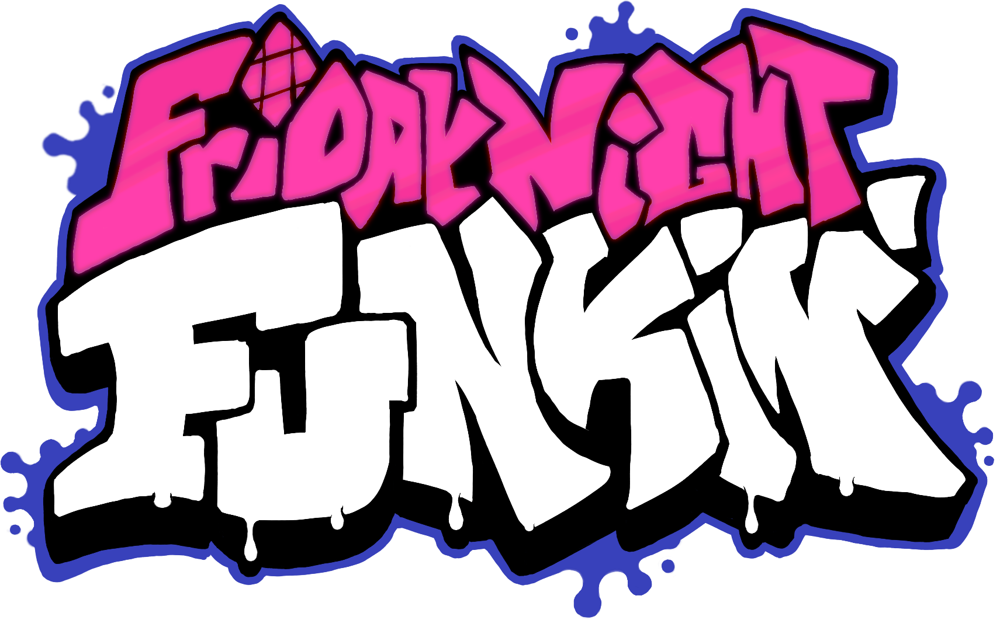

<div align='center'>

<h2>Friday Night Funkin' is a rhythm game. Built using HaxeFlixel for <a href="https://ldjam.com/events/ludum-dare/47">Ludum Dare 47.</a></h2>

This game was made with love to Newgrounds and its community. Extra love to Tom Fulp.

</div>

# R-Slice (AKA: RAID Engine)

**R-Slice is a Friday Night Funkin' engine** — a full rhythm-game host with
song select, story mode, a chart editor, mod support, and Psych Engine-style
scripting — built on the **V-Slice** codebase lineage. It is not a
FNF-*styled* clone and not just a chart format: the format, the streaming
decoder, and the whole playable engine ship together.

The engine's reason to exist is density. FNF charts are normally JSON files
that are fully materialized in memory before a song starts — and **that
path still works exactly the same**: every ordinary FNF song plays through
the regular JSON pipeline with no `.raid` involvement. R-Slice adds the
`.raid` binary chart format and a streaming playback path on top, for
**massive charts** — charts orders of magnitude larger than RAM, where note
counts reach into the trillions, with bounded memory, 120–240 FPS, lossless
chart data, and random access. You only need the RAID pipeline when a chart
is too big to live in memory; everything else is a normal FNF engine.

> **Release target:** the full engine — `.raid` format, streaming decoder,
> Freeplay integration, editors, and tooling — is expected to be feature
> complete and publicly released **by Christmas Day (December 25th)**.

---

## The `.raid` format

A versioned 128-byte header followed by independently addressable sections:

- **Chunk index** — fixed-size entries giving each chunk's time range, event
  range, file offset, sizes, and CRC32. Playback binary-searches by time
  without decoding anything.
- **Metadata** — deflate+CRC32 JSON: title, difficulty, tempo, sections,
  focus, note types, `lengthMs`, `playerNotes`/`opponentNotes` totals.
- **Pattern table** — deflate+CRC32 reusable event sequences with pitch/lane
  transforms and nesting (patterns can contain pattern instances, i.e. not
  loading every note into memory).
- **Chunks** — independently compressed op streams. Three op kinds:
  - *Literal absolute*: columnar storage — delta-varint times, lengths,
    zigzag pitch, lanes, packed side/kind/flags, types, stacks.
  - *Literal relative*: the same columns inside pattern definitions,
    relative to the pattern origin.
  - *Pattern instance*: `patternId, repeatCount, anchorUs, pitchDelta,
    laneDelta` — the decoder re-emits the pattern per repeat, transformed.
    Version 2 adds overlapping pattern *groups* and burst repeats (the
    FL-Studio-playlist case).

The encoder detects repeated runs (≥8 events), extends consecutive identical
blocks into repeat counts, and transposes uniform pitch/lane shifts (the
keyboard-grid case). It reports honest statistics — `logicalEvents` vs
`literalEvents` vs `patternCount`, raw vs stored bytes — and never fakes a
compression ratio on incompressible data.

Safety: the encoder validates every timestamp, pitch, lane, and transform;
the decoder bounds time accumulation, transform magnitudes, nesting depth,
chunk expansion, section sizes (512 MiB), and verifies CRC32 and declared
counts everywhere. Malformed input cannot cause unbounded allocation, time
overflow, or excessive recursion (400-iteration fuzz suite).

## Streaming decoder

- `open()` reads only the header + index — a few KB regardless of chart size.
- `range(startUs, endUs, out, err, indices)` decodes only overlapping chunks
  and returns events **with global expanded indices** — stable ids without
  materialization.
- `chunkEventsAsync` decodes on worker threads; an LRU chunk cache, a decode
  semaphore, and a configurable memory budget bound concurrent work.
- Internally refcounted: async jobs survive reader destruction, `FILE*` I/O
  is serialized, the cache is mutex-protected — safe for concurrent
  `range()` + prefetch + shutdown.
- `opLog()` walks the encoded op stream (not expanded events) and returns
  `OpSegment`s: literal runs and **leaf** pattern instances with time ranges,
  repeat counts, and transforms — the only place pattern identity survives.
- `PatternLogger` ticks with the playhead and appends segments to a file,
  marking every pattern→pattern change.

## Chart bridge + rolling playback window

- `raid::ChartStream`: a metadata-only `Chart` (notes stay empty; totals and
  `lengthMs` come from the header/meta) plus `pump()` — windowed events
  with global indices — and `prefetch()` for worker-side chunk warming.
- `Session`: `appendLaneNote()` feeds events in global time order
  (per-lane order preserved, so cursors/judgement/holds are untouched);
  `gcBefore()` drops resolved notes beyond an adaptive GC margin sized to
  the visible scroll reach — lane memory is bounded by note **density**,
  not chart length.
- `PlayState`: `.raid` charts pump events up to `songMs + lookahead`,
  prefetch ahead, flip sides under mirror mode, and GC per frame.
  `drawLanes` uses a pixel-aware fast path (time-ordered lanes + sustain
  index) that inspects only notes that can produce distinct on-screen
  positions instead of scanning the whole time window.

---

## Putting songs into Freeplay

The song library scans `songs/`, `mods/`, and any dropped Psych/JS-Engine
mod folders at startup (press **R** on the song select to rescan). A song
appears in Freeplay when its folder contains **audio** (the Inst track) and
**chart files** — ordinary `.json` charts included; the RAID pipeline is
optional. `.raid` files are also first-class charts: drop one into a song
folder and it is picked up automatically — no conversion step needed at
play time.

> **Note:** this repository ships **without `assets/` and `art/`** (the
> multi-GB V-Slice asset set is excluded from git — see `.gitignore`).
> Download the asset pack from the repo's **Releases** page
> (`assets-vslice.zip`), then extract it into the repository root so the
> `assets/` and `art/` folders sit next to `project.hxp` — see
> [Installing the assets](#installing-the-assets) below.

### Folder layout that works

```text
songs/
  mysong/
    Inst.wav            # the instrumental (any common audio format)
    voices.wav          # optional vocal track(s)
    mysong.raid         # Normal difficulty — name must match the folder
    mysong-hard.raid    # Hard difficulty
    -metadata.json      # optional V-Slice metadata (title, difficulties)
```

Difficulty naming: `<foldername>.raid` or `<foldername>.json` is Normal;
`<foldername>-<diff>.raid` adds another difficulty. The scanner also accepts
loose audio files directly in `songs/` — those get an **AutoChart** entry.

### Making a song from scratch (the "song maker" pipeline)

1. **Get audio.** Drop an `.mp3`/`.wav`/`.ogg` into `songs/` as a loose file,
   or create `songs/<name>/` and put the Inst track inside.
2. **Chart it.** Three routes:
   - **AutoChart** — open Freeplay, select the song (marked "AutoChart"),
     press **ENTER** to play. The engine detects beats and generates a
     playable draft chart on the fly.
   - **Chart editor** — in Freeplay select the song and press **7**. You get
     a Psych/JS-Engine-style grid: time flows down, opponent lanes above the
     line, player lanes below. Place notes with the mouse, snap to
     1/4–1/192 beats (**LEFT/RIGHT** changes snap), hold notes with
     **Q/E**, section BPM with **[ ]**, and **SPACE** to playtest.
     **F2** / **Ctrl+S** saves legacy Psych 0.x JSON that this engine,
     Psych Engine, and JS Engine all read. Saving an AutoChart draft or a
     built-in song writes a real chart file into `songs/`.
   - **Convert an existing chart** — see `raid_engine convert` below. This
     is the route for FNF JSON, V-Slice, PulseForge, or FL Studio sources.
3. **Rescan** — press **R** in Freeplay (or restart) so the library picks up
   new/changed files.

### `.raid` in Freeplay — for massive charts only

A `.raid` chart streams: metadata loads instantly, notes pump in playback
windows. Use it when a chart is too large for the normal JSON path — for
everything else, plain `.json` charts play identically. On the song select
a `.raid` behaves exactly like a JSON chart — preview, difficulty arrows,
modifiers, scores, and the pattern log all work.

**In-game pattern log** — Freeplay → **TAB** → "Pattern log (.raid)" writes
`<userDir>/raid_pattern_log.txt` during playback, marking every
pattern→pattern change. On `taimuresu.RAID` (75,819 events → 89 KB, 3.72×):
4,160 op segments, 3,003 pattern instances, 1,849 pattern→pattern changes.

### Character packs (`.rchr`) — early development

`.rchr` is a pack format for bundling character/stage asset folders into a
single file (built on the same deflate+CRC container ideas as `.raid`).
`raid_engine convert` accepts `--opponent-pack`/`--player-pack` to record an
external `.rchr` reference in the chart trailer, or `--*-pack-embed` to store
the bytes directly; `--*-name` overrides the character name. `rchr pack`,
`rchr list`, and `rchr unpack` manage the archives.

**Status: in development.** The format and CLI work, but `.rchr` mounting in
the game is not finished — treat it as experimental and expect changes.

---

## `raid_engine` — the CLI

`raid_engine.exe` is the source of truth for all format work. It builds
from `engine/` (`cmake --build engine/build --target raid_engine`, or
`tools/build_engine.*`) — see `engine/README.md`.

### Converting charts

```text
raid_engine convert <chart|flp|fsc> <out.raid>
    [--opponent-pack f.rchr] [--player-pack f.rchr]
    [--opponent-pack-embed f] [--player-pack-embed f]
    [--opponent-name n] [--player-name n]
```

Input goes through `loadChartFile`: Psych/FNF JSON (`chart.json`,
`<song>-<diff>.json`), V-Slice charts, PulseForge (`chart.json`,
`.pfchart.json`, autosaves), and **FL Studio `.flp`/`.fsc`** projects via
SNIFF pattern detection — lossless conversion to `.raid`. Pack flags embed
or reference `.rchr` character packs (see above; still in development).

```text
raid_engine info <file.raid>                     # header + encoder stats
raid_engine verify <file.raid>                   # full decode, note count
raid_engine window <file.raid> <startMs> <endMs> # streaming window dump
raid_engine meta <file.raid>                     # raw metadata JSON
raid_engine patterns <file.raid> [startMs] [endMs]
                                                # op-stream log: which
                                                # pattern plays when
raid_engine flppatterns <file.flp>               # per-pattern charted-note
                                                # census for FL Studio files
raid_engine upgrade <file|dir>...                # re-stamp format version
```

`verify` is the integrity check to run after any conversion or edit — it
decodes the entire file, counts events, and validates every chunk CRC.
`window` is the "show me exactly what the decoder emits for this time
range" tool — useful for diffing conversions.

### `raidedit` — editing `.raid` files without materializing them

```text
raid_engine raidedit <file.raid>                 # interactive REPL
raid_engine raidedit <file.raid> "cmd" "cmd" ... # scripted edits
```

Edits the two structural layers: the **pattern table** (op lists, spans,
stats) and the **timeline's pattern placements** ("spawns"). Every edit is
validated by a full structural re-analysis (decode ordering, repeat
spacing, chunk ranges) and rejected with rollback if it would corrupt the
stream; `save [out.raid]` rewrites the file (in-place keeps a `.bak`).

Interactive commands (`help` inside the REPL lists them all):

| Command | What it does |
|---|---|
| `info` | version, logical events, pattern/chunk counts, length |
| `patterns` / `pattern <id>` | list the pattern table / dump one pattern's ops |
| `chunkops <c>` | dump a chunk's op stream |
| `spawns` / `spawn <idx>` | list / inspect pattern placements on the timeline |
| `add <ms> <patId> [reps] [pitch] [lane]` | insert a pattern instance |
| `addb <ms> <patId> <reps> <strideUs> [pitch] [lane]` | insert a burst repeat |
| `sset <idx> k=v...` | edit a spawn's fields |
| `gset <idx> <ent> k=v...` | edit one group entry (`winlo`/`winhi` in ms) |
| `pset <patId> <opIdx> k=v...` | edit inst/burst fields inside a pattern def (`pat= reps= anchor= pitch= lane= stride=`) |
| `pspan <patId> <spanUs>` | set a pattern's repeat span |
| `pdel` / `sdel` / `delop` | delete ops, spawns, or chunk ops |
| `analyze` | re-run structural validation |
| `save [out.raid]` | write the file (default: in-place, `.bak` kept) |

Overlapping placements that the flat op log can't express need op-3 group
edits via `gset`.

### Benchmarks & generators

```text
raid_engine bench <file.raid> [jobs]    # decode throughput; jobs=N = parallel
raid_engine slicebench <file.raid>      # sliced decode path
raid_engine chunkbench <file.raid> [windowMs] [iters] [seekIters]
raid_engine densbench <file.raid> [rt] [seed]   # density benchmark; rt = realtime-paced
raid_engine eval <file.raid> <startMs> <endMs> [iters] [verify]
                                        # decode a window repeatedly;
                                        # verify = self-check expanded output
raid_engine streamtest <file.raid>      # decode the whole stream end-to-end
```

Synthetic chart generators for stress-testing (all write valid `.raid`
files you can `verify`, `window`, and play):

```text
raid_engine repgen   <out.raid> <repeats> <motif> <periodMs> [chunkEv] [stack] [keys]
raid_engine litgen   <out.raid> <events> <durationMs> <chunkEvents> [keys]
raid_engine stressgen <out.raid> <repeats> <motif> <periodMs> [stack] [keys]
raid_engine densgen  <out.raid> <sec> <evPerSec> <chunkEvents> [susEvery] [overlapEvery] [keys]
```

`densgen` is the one that matters for the trillion-note story: it emits a
chart at a target events-per-second density for N seconds. `densbench`
then measures whether decode keeps up.

### `raidtool` — GUI front-end

`raidtool.exe` wraps `raid_engine.exe` — the CLI stays the source of truth;
the tool shells out to it, streams stdout into a log pane, and plays UI
sounds on actions.

Workflow: pick FILE (single input) or FOLDER (batch), add EXTRA ARGS if
needed, optionally set OPP / PLAYER `.rchr` character packs, press an
action — jobs run in the background. Actions: CONVERT, VERIFY, INFO,
UPGRADE, META, STREAMTEST, WINDOW, PATTERNS, RAIDEDIT, the generators, and
`rchr` pack/list/unpack. A first-run TOUR explains everything in-app.

---

## Building the engine — the official way

**RAID ships inside this repository** — the game is written in Haxe and
transpiled to **C++20** by hxcpp through Lime/OpenFL. The RAID engine
itself is C++20: its core (`raid.cpp`, `raid_chart.cpp`, `session.cpp`,
`engine_abi.cpp`, …) is compiled into static libraries, and the game build
links those libraries plus a thin C++ shim
(`source/funkin/external/raid/project/src/raid_bridge.cpp`) that exposes
the engine's C ABI to Haxe. Building RAID means two builds: the engine
libs, then the game.

### Prerequisites

- **Git**, **CMake ≥ 3.20**, a **C++20 compiler** (Visual Studio 2022
  Build Tools on Windows — MSVC v143 + Windows SDK)
- **Haxe** (haxe.org), **haxelib**, and **hmm** — Funkin's patched
  haxelib/hmm are recommended:
  `haxelib --global git haxelib https://github.com/FunkinCrew/haxelib.git`
  and `haxelib --global git hmm https://github.com/FunkinCrew/hmm.git`
- `haxelib run lime setup` after installing lime
- `assets/` and `art/` are **not in this repo** — install the asset pack
  (below) or the game has nothing to play.

### Step 1 — build the engine libraries

The engine source lives in **`engine/`** in this repo (see
`engine/README.md`). Build the libraries the game links:

```sh
tools/build_engine.bat              # Windows: MSVC libs + Android ABIs
tools/build_engine.sh               # git-bash / Linux / macOS
# or directly:
cmake -S engine -B engine/build-msvc -G "Visual Studio 17 2022" -A x64
cmake --build engine/build-msvc --config Release --target gh_core
```

This produces `engine/build-msvc/Release/gh_core.lib`, `gh_lua.lib`,
`gh_miniz.lib` (plus `raid_engine` and `gh_tests` on desktop). First
configure downloads pinned deps (Lua 5.4.7, miniz 3.0.2, raylib for
`raidtool`) — needs internet unless you vendor `engine/third_party/`.

### Step 2 — the game picks it up automatically

`source/funkin/external/raid/project/Build.xml` resolves everything
relative to the repo — **no manual edits needed on a fresh clone**. It
expects the libs at `engine/build-msvc/Release/` (Windows) or
`engine/build-android/<abi>/` (Android). If your engine checkout lives
elsewhere, set the `RAID_ENGINE_ROOT` environment variable (or `-D`
haxedefine) to its root instead.

### Step 3 — build the game

```sh
hmm install                      # once: fetch haxelibs for the branch
lime build windows -release      # or: lime test windows  (build + launch)
```

Output: `export/release/windows/bin/R-Slice.exe` — window title
"R-Slice Engine". Useful flags: `-DREDIRECT_ASSETS_FOLDER` for fast
iteration, `-DNO_FEATURE_VIDEO_PLAYBACK` to skip VLC/cutscene support,
`-DNO_FEATURE_POLYMOD_MODS` to disable modding, `-debug` for the debug
build. See `docs/COMPILING.md` for the full flag list.

That's it — `R-Slice.exe` is the official RAID-enabled build. Songs with
`.raid` charts stream through the engine; everything else plays through
the normal JSON path.

### Installing the assets

The game needs the V-Slice asset set (songs, sprites, characters, videos,
fonts) which is **not stored in git** — it's distributed as a single zip on
the repo's [Releases](../../releases) page:

1. Download **`assets-vslice.zip`** from the latest release.
2. Extract it **into the repository root** — the zip contains `assets/`
   and `art/` at its top level, so after extraction you should have:

   ```text
   R-Slice-Main/
     project.hxp
     assets/          <- songs, sprites, videos, fonts
     art/             <- app icons
     source/
     ...
   ```

   On Windows: right-click the zip → *Extract All* → choose the repo
   folder. On macOS/Linux: `unzip assets-vslice.zip -d <repo-root>`.
   If your extractor nests everything inside an `assets-vslice/` folder,
   move the `assets/` and `art/` folders up one level.
3. Rebuild (or just run `lime test windows`) — `project.hxp` picks up
   `assets/` automatically.

That's the full V-Slice content set: base FNF weeks, the V-Slice campaign
weeks, character/stage sprites, fonts, and videos — everything Freeplay,
Story Mode, and the editors need.

### Android APK — `tools/Androidify`

`tools/Androidify.bat` (Windows) and `tools/Androidify.sh`
(git-bash/Linux/macOS) automate the Android build: they check Haxe,
haxelibs, JDK 17, Android SDK/NDK, lime's Android `ndll` libs, and lime
config — and with `--install` they download the missing pieces (Temurin
JDK 17, Android cmdline-tools, `platforms;android-29/35`,
`build-tools;35.0.0`, `ndk;29.0.13113456`, and the lime `ndll/Android`
`.so` files that git checkouts don't ship). Point `ANDROID_HOME` at your
SDK if it isn't the default location.

```text
tools\Androidify.bat --check     # verify toolchain only
tools\Androidify.bat --install   # fetch missing pieces, then build
```

The APK lands at `export/release/android/bin/app/build/outputs/apk/debug/`.
Debug APKs are large (~1 GB — uncompressed assets + both ABIs); video
playback is compiled out on Android (`-DNO_FEATURE_VIDEO_PLAYBACK`) because
hxvlc ships no Android VLC libraries.

> **`.raid` on Android:** supported — `Androidify` builds the engine's
> per-ABI static libs (`engine/build-android/<abi>/`) before invoking
> lime, and the Haxe bindings are enabled for `windows || android`.
> The GL instrumentation path (`RaidGLSmoke`) remains Windows-only; note
> batching falls back to the CPU path on Android.

---

## Operating the engine

`R-Slice.exe` is the playable game. Useful command-line flags (lime build):

```text
R-Slice.exe --chart <chart> --stage <stage> --song <song>   # debug launch
R-Slice.exe --help --version
```

In-game: **7** on the main menu opens the editors menu (chart, character,
stage, events); **7** in Freeplay opens the chart editor for the selected
song; **TAB** in Freeplay opens modifiers (scroll speed, note modifiers,
key count); **M** opens mod packs; **R** rescans songs/mods; **SPACE**
previews the selected song. SNIFF: drag an `.flp`/`.fsc` onto the game
window to import it through the FL Studio path.

---

## The game — R-Slice

R-Slice's codebase is V-Slice, so you can guarantee it will have the same
songs as Base FNF up to V-Slice Version 0.8.6 (the latest GitHub release of
V-Slice as of writing this). You can play the base FNF songs in Story
Mode, Freeplay, or edit them to your will. There are 5 difficulties ranging
from Easy to Nightmare Erect mode, some songs have different mixes when
you play as Pico instead of The Boyfriend. If you want to make a mod in
R-Slice, there's not that much to use besides utilizing RAID for its chart
efficiency for dense charts, but you can use the freeplay song generator
feature for convenience. (Not everything works however). There is a
planned Archipelago MultiWorld Randomizer mod as a set example for mod
implementation on this engine.

## Honest limitations

These are the real walls between "designed for trillions" and "plays
trillions today":

- **Authoring is still materialized.** The *encoder* input is a fully
  materialized `Chart` — you cannot author a trillion-note song directly;
  you produce a dense JSON/FLP chart first, then convert. Trillion-event
  *authoring* is future work; the format/decoder/playback path supports it.
- **Decode throughput is finite.** ~1.3–2.4M events/sec on the gameplay
  path means a chart must average under ~2M notes/sec *in any sustained
  stretch* to keep up — extreme density spikes (multi-million notes/sec)
  will outrun realtime decode until the decode pipeline gets faster. The
  format stores them fine; playback margin is the open problem.
- **Script note access degrades on `.raid`.** `noteOrder_`/`noteRef`/
  `noteCount` return empty — Psych scripts that enumerate notes see none.
  Judgement, holds, and scoring are unaffected.
- **The chart editor cannot edit `.raid` charts.** It loads
  `chart.notes`, which stays empty for streamed charts — `.raid` files are
  play-only in-game. Edit the source JSON, re-convert, or use `raidedit`
  for structural edits.
- **Rewind is bounded.** `loopSong` works within the adaptive GC margin
  (sized to scroll reach, much smaller than the old fixed 30 s); farther
  back, dropped notes can't replay. `restart()` always works.
- **`LaneNote::id` is `uint32_t`** — wraps past 4 G events (only affects
  script ids, which don't work on streams anyway).
- **Rendering is still per-note draws.** The `drawLanes` fast path removed
  the O(window) CPU scan, but each visible note is still an immediate-mode
  draw. GPU instancing/compute is designed but not implemented — at extreme
  on-screen density the draw-call count, not memory, is the next wall.
- **`.rchr` character packs are in development** — format and CLI exist,
  in-game mounting is unfinished.
- **`.raid` supports Windows and Android** — the Haxe bindings are gated
  to `cpp && (windows || android)`; macOS/Linux/iOS play JSON charts
  only until engine libs are wired for those targets.
- **GL note batching is Windows-only** — `RaidGLNotes`' instanced-GL
  backend (`RaidGLSmoke`) uses WGL and stays Windows-gated; other
  platforms use the CPU draw path.
- **The pattern log reports encoded ops**, not visual note patterns — it's
  a map of pattern→pattern changes, not what the player saw.

## Credits

dejatuamae67-crypto for some engine features and for hosting the old
codebase for R-Slice / TofpFL, built on the V-Slice engine lineage with
ideas and features from PulseForge (same author). Event, effect, and script
behaviour follow [JS Engine](https://github.com/JordanSantiagoYT/FNF-JS-Engine)
(Apache-2.0) and Psych Engine; the code and shaders are our own. Built with
[raylib](https://www.raylib.com) (zlib), [Lua](https://www.lua.org) (MIT),
[miniz](https://github.com/richgel999/miniz) (MIT) and
[pl_mpeg](https://github.com/phoboslab/pl_mpeg) (MIT). Fonts: Cinzel
Decorative and Rajdhani, both SIL OFL. Code under the MIT license; mod
packs are the user's own content.
(still crediting JS for his works because I am not just some random asshole)
